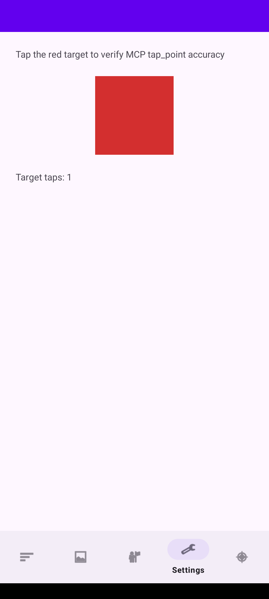

# Maintenance verification — 12 November 2026

Base: `5d6d16d67a7cd08069f3d69c2d484249e2ed8485`.
All five isolated reviews were integrated. No open GitHub issues or PRs were
present at the initial review or the final pre-PR check. Recent changes reviewed
included #57–#61 (SwiftUI input/lazy grids, Bonjour, release and Flutter lookup).

## Source and environments

| Review | Pushed revision |
| --- | --- |
| Apple | `80838116f106cf7b650cd9cf1904bbc84916151a` |
| Android / React Native | `0f970af3b782086b4d716bbd383ff2dbe976a263` |
| Flutter | `d4de05b30c3373f7307b14ee706d9f2d3c62a2ee` |
| Windows / Tauri | `913c06f8246e6b29a34c1e9af81176dff91bc88f` |
| CLI / CI | `30e02a0f11b4c3ca68b9366e9a62de47c0e4b444`, `0f081c97ce9dec980e39e4aebc9708505d1cc207`, `a3f93a7db54857dc50adcec706ba9bbbc87a9d2c` |

The coordinated native/portable run used validation snapshot
`8720e9fcd74ffd568a02d5bcf5756ad2daa32602`, tree
`64e539149c0a005ac1c1e8abcbbcb6a3920333a7`. Apple, Android, Flutter and
Windows source directories in that snapshot match the delivered implementation.
The subsequent RN Swift scalar-result correction was compiled and its Foundation
contracts rerun on dictator. Windows CI then exposed Node 20 glob handling in
the CLI test command. Naming the two test files explicitly fixed discovery;
Maxis lint, typecheck, build and all 24 tests passed with Node 20.20.2 against
validation snapshot `a8d8b6ab5d77d158eeaaf2ebabb8860331633b98`. CLI runtime
source is unchanged from the coordinated native probe. Documentation, evidence and CI additions do not
change those native build inputs. The PR identifies the final integration head.

- **dictator:** macOS 27.0 / 26A5378j, Xcode 27.2 / 27B52; existing iPhone
  simulator `2176C913-0551-42B1-9A1B-D97A25F6CC0A`, iOS 26.5.
- **Maxis:** Windows 11 Pro / build 26300.9711; Node 24.19.0, pnpm 10.22.0,
  Flutter 3.50.0 / Dart 3.14.0, .NET SDK 10.0.404 with WindowsDesktop 8.0.34,
  Rust 1.99.0, Tauri 2.12.5 / WebView2 157. Builds and fixtures ran on C:.
- **Ubuntu (umac):** JDK 17.0.20.1, Android SDK; reused `kelpie-phone`,
  `emulator-5554`, Android API 34. No Minis or Fedora workloads were used.

## Outcomes

| Area | Coordinated outcome |
| --- | --- |
| Apple automated | 42 macOS package tests, 27 iOS package tests, 9 hosted UIKit/SwiftUI tests; strict SwiftLint zero violations; Release Swift and both example builds passed. |
| Apple live HTTP | 52 macOS and 97 iOS authenticated tool calls, plus 401 rejection and initialization. Navigation, text changes and restoration, state, diagnostics, failure/recovery, batch stopping and screenshots passed. iOS exercised real WebView controls. Both PNGs were decoded and inspected. |
| Android | 11 unit tests, ktlint, lint, debug AAR, no-op release AAR and example debug/release builds passed. 113 authenticated calls passed on API 34, including native/Compose changes, scrolling, state readback, WebView errors/recovery, batch failure, PNG/JPEG and Compose crop. |
| React Native | Maxis library/example typechecks, library lint and 4 JS tests passed. Ubuntu standalone native Android build/lint and 8 tests passed. All Swift library sources compiled for iOS Simulator on dictator; Foundation contracts passed, including scalar/null WebView values and nested error propagation. |
| Flutter | Package/example analysis clean; 59 tests passed. Real Windows example passed authenticated HTTP login, typing/clear, taps, inventory, scrolling, cart/state, navigation, tabs, dialogs, profile save, diagnostics, batch recovery and PNG/JPEG. Chrome executed 23 DOM payload checks. |
| Windows .NET | Debug/Release builds and 22 authenticated HTTP/provider checks passed. Real WinForms/UIA fixture passed 34 checks with state readback, failed actions/recovery and image decoding. |
| Tauri | 37 Rust tests with mDNS and 37 with the Tauri feature passed. Real WebView2 fixture passed 30 HTTP checks, including stable IDs after insertion, Unicode, disabled/read-only failures and recovery. |
| CLI / CI | Lint, typecheck, build and 24 tests passed on Maxis. Thirteen live probe steps against the rebuilt macOS app passed authentication, inspect/snapshot, navigation/state, failure/recovery and text operations. actionlint 1.7.12 passed the integrated workflow. |

The unhandled macOS deep-link check originally opened Finder's application
chooser. The final implementation checks for a registered handler first; its
regression and live failure path passed without another chooser.

## Boundaries

These are not passed runtime checks:

- React Native has no native example host projects. Compilation does not prove
  autolinking, JS-controlled input, touch dispatch, native navigation or WebViews.
- Android separate Dialog windows and Compose `scroll_to_element` are not
  supported by the inspected Activity-View path. The tool now states its native
  View limitation; Compose direction scrolling and captures were exercised.
- Flutter Windows has no native `webview_flutter` backend. Chrome tests cover DOM
  payloads only. Mobile/macOS Flutter, external deeplinks and mDNS were not run.
- WPF, WinUI, Avalonia, custom .NET WebView providers, Tauri on macOS/Linux, React
  frontend tracking, successful external desktop deeplinks and packaging/signing
  were not run. Native desktop navigation proves shortcut delivery; host routing
  still determines its effect. Unsupported generic Tauri tools are not advertised.
- Apple physical devices, older runtimes, signing and sandbox distribution were
  not run. Positive macOS WebView behavior uses actual WKWebView package fixtures.
- Maxis mDNS discovery found zero apps in the review; direct authenticated LAN
  requests succeeded. No discovery success is claimed.

## Visible example changes

The Android Tap Test destination referred to a missing fragment/layout at the
base. Its new working calibration view is the only captured changed screen.
The RN example's corresponding missing component was restored for compilation;
its rendering remains unverified because native hosts are absent. No existing
example screen was redesigned. Windows fixtures are test-only hosts.

| Before — Android Tap Test | After — Android API 34 |
| --- | --- |
| No functional prior screen: the base destination referenced missing implementation. |  |

Reproduction links and platform-specific boundaries are in
[maintenance verification](../maintenance-verification.md). Sanitized run logs
and manifests are retained separately from disposable worktrees. Session URLs
and launch logs containing credentials are excluded from published evidence.
